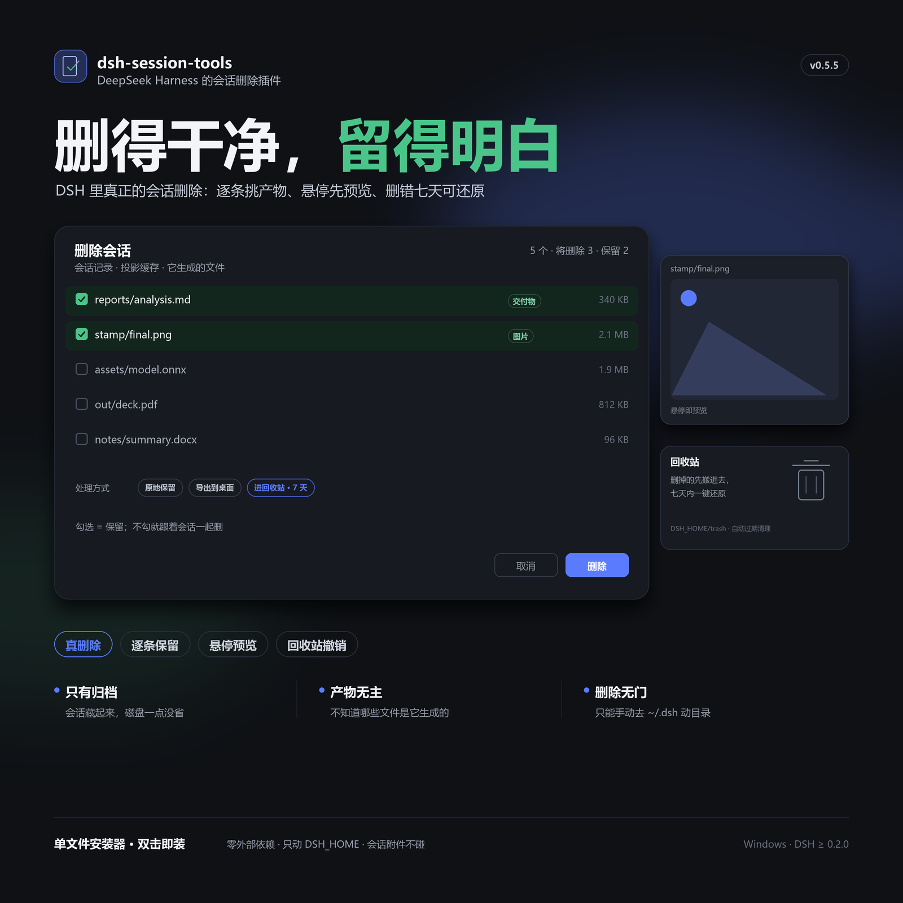
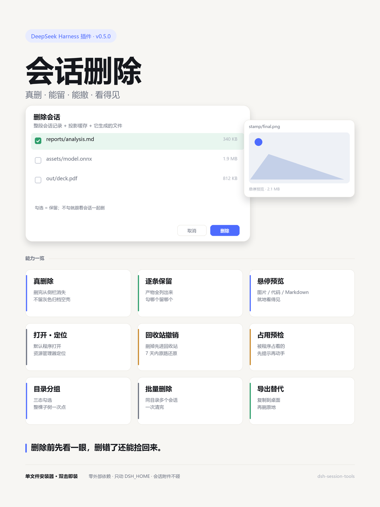

# dsh-session-tools

> **原创作者：Weilong** · 版本 0.5.14 · **免费开源（MIT）**
>
> 你可以自由使用、修改、再分发，甚至可以商用 —— 唯一的要求是保留版权声明和作者署名
> （MIT 许可本身就是这么规定的，见 [LICENSE](LICENSE)）。
> 既然不要钱，那就让用的人知道是谁写的：插件对话框底部、安装器输出、`package.json`
> 和 `ping` 接口里都带了 "原创作者 Weilong"。

> **DeepSeek Harness 的会话删除插件**：真删除、逐条勾选保留、悬停预览、回收站撤销、产物导出。
>
> DSH 原生只有「归档」，没有删除。这个插件补的就是这一块：会话行右侧 `…` 里多两行
> **删除会话…** 和 **批量删除会话…**，点开先看清单，确认后才落盘。



## 版本约定

本项目用 `MAJOR.MINOR.PATCH`（语义化版本），但 **0.5.x 期间 PATCH 位也可能带新功能**——
前面几版（回收站面板、强制删除、批量强制/撤销、侧栏刷新按钮）都是按补丁发的，
目的是让已经装上的用户版本号连续、不用怀疑"是不是换了东西"。

因此：**1.0.0 之前不承诺接口兼容**。真要对外宣称稳定，等这三个条件齐了再打 1.0.0：
回收站/批量/刷新这套 UI 打磨完、mac 有真机验证、`ping` 的 `caps` 不再加字段。
## 安装

**① 从插件市场 / 仓库直接装（推荐）**

```bash
dsh plugin add github:AndezY/dsh-session-tools
```

装完重启 DeepSeek Harness。

**② 直接下载安装包（仓库内镜像，链接永久有效）**

文件名固定、不带版本号——每次发版只覆盖同名文件，下面的链接永远不用改。
当前版本与 sha256 记在 [`release/VERSION.json`](release/VERSION.json)。

| 平台 | 下载 |
|---|---|
| Windows | [`installer-windows.cmd`](release/installer-windows.cmd) |
| macOS | [`installer-mac.zip`](release/installer-mac.zip) · 备用 [`installer-mac.tar.gz`](release/installer-mac.tar.gz) |

命令行取：

```bash
curl -L -o install.cmd https://github.com/AndezY/dsh-session-tools/raw/main/release/installer-windows.cmd
```

想核对下载到的文件，看 [`release/VERSION.json`](release/VERSION.json) 里的 `sha256`：

```powershell
Get-FileHash .\install.cmd -Algorithm SHA256
```

**③ 一键安装器怎么用（Windows）**

下载最新 Release 里的 `dsh-session-tools-*-windows-installer.cmd` → 完全退出 DSH（托盘右键退出）→ 双击 →
按 `1` → 重新打开。安装器会自己找 `DSH_HOME`、改 `package.json`、跑 pnpm，
并且带备份、带 `--status` / `--uninstall`。

**④ 在 DSH「插件 → 添加插件」对话框里装（国内网络推荐这两条）**

那个输入框收四种写法（解析规则来自 `@deepseek-ai/dsh-plugin-manager` 的 `parseInstallSpec`）：

| 写法 | 例子 | 说明 |
|---|---|---|
| npm 包名 | `dsh-session-tools` | 走 npm registry，下拉里可选「中国大陆镜像源」。**注意**：npm 上 `dsh-session-tools` 这个名字已经被人占了（0.1.0），本插件没有发布到 npm |
| git 仓库 | `github:AndezY/dsh-session-tools`<br>`https://github.com/AndezY/dsh-session-tools`<br>`https://gitee.com/<你的id>/dsh-session-tools` | pnpm 直接 clone，**「中国大陆镜像源」对它无效**，国内需要代理 |
| tarball | `C:\Downloads\dsh-session-tools.tgz`<br>`https://.../dsh-session-tools.tgz` | 本地绝对路径或 http(s) 地址，`release/dsh-session-tools.tgz` 就是这份 |
| 本地目录 | `C:\Downloads\dsh-session-tools` | **绝对路径**，指向含 `package.json` 的那个目录；零网络，最稳 |

国内最省事的两种：

1. 下载 [`release/dsh-session-tools.tgz`](release/dsh-session-tools.tgz)，对话框里填它的**绝对路径**
2. 下载 [`release/installer-windows.cmd`](release/installer-windows.cmd) 双击（完全不走这个对话框，也不需要网络，因为它把插件整包塞在文件里）

**⑤ 手动装**

```bash
git clone https://github.com/AndezY/dsh-session-tools ~/.dsh/plugins/dsh-session-tools
# 然后在 ~/.dsh/profiles/desktop/package.json 里加：
#   dependencies: { "dsh-session-tools": "file:../../plugins/dsh-session-tools" }
#   dsh.profile.bundles: [ ..., "dsh-session-tools" ]
```

## 支持范围

| 平台 | 状态 |
|---|---|
| Windows + DSH 桌面端 0.2.0+ | ✅ 已验证 |
| macOS + DSH 桌面端 | ⚠️ 代码跨平台（`open` / `open -R` 分支已在），mac 安装器 `dist/mac/install-mac.command` 也写了，但**没有在真机上验证过**——愿意当小白鼠的欢迎提 issue |

会话记录、投影缓存、回收站都在 `~/.dsh` 里，跨平台路径一致。

## 先说一个前提：DSH 本身没有"删除会话"

DeepSeek Harness 只提供**归档**：会话从列表隐藏，空间一点没省，归档多了还得翻页去找。
想真删就得自己进 `~/.dsh` 手动动目录——而侧栏的列表不是扫目录得来的，它在
`workspace.json` 里给每个会话记账，手删目录会留下点不开的行。

所以这个插件不是"修 bug"，是**补一个 DSH 没有的能力**。对照一下：

| DSH 原生 | 加上这个插件 |
|---|---|
| 只有「归档」：对话藏起来，磁盘占用不变，归档多了越滚越多 | **真删除**：会话记录、投影缓存、工作区账目一起清，列表和磁盘同时干净 |
| 会话生成的文件散在项目目录里，不知道哪些是它产出的，不敢动 | **产物清单**：逐条列出来（含来源标签），可预览、可打开，勾哪个留哪个 |
| 想清空间只能手动去 `~/.dsh` 删目录，删完列表里还留着点不开的空行 | 路径在宿主里重算并校验，删完顺手把账目摘掉，不留残影 |
| 没有"删错了怎么办" | 默认先进**回收站**，7 天内「撤销」原路还原（文件和会话记录都能回） |

## 我们额外塞进去的东西

这些不是补缺，是既然做了删除就顺手做全：

- **按目录分组**的产物列表，目录头三态勾选，一次处理整棵子树
- **悬停预览**（图片缩略图 / 代码前 18 行 / Markdown 渲染）、双击用默认程序打开
- **占用预检**：被 Word/Excel 占着的文件先标出来，默认勾成保留，不会删到一半报错
- **导出而不是保留**：勾中的文件复制到桌面「会话导出-<标题>」，复制成功才删原地
- **批量删除**：同一工作目录下多个会话一次清完
- **回收站面板**：侧栏页脚常驻入口，列批次 / 看体积 / 还原 / 彻底删除 / 打开文件夹



## 实现笔记：为什么"只删目录"不够（v0.1.0 我踩过的坑）

> 这一段是作者视角的技术记录，不是 DSH 的问题，也不该算用户的困扰——
> 记在这里是因为它决定了 v0.2 之后的所有设计。

DSH 的侧栏列表不是扫目录得来的，会话要先在 `$DSH_HOME/storages/workspace.json` 里记账：

| 账目 | 位置 | 手删目录的后果 |
|---|---|---|
| 工作区成员 | `tables.workspaces[<ws>].sessionIds` | 侧栏继续给这个 id 留位置 |
| 归档集合 | `global.archivedSessionIds` | 行显示为灰色"已归档"，且 `ArchivedSessionGate` 会挡掉后续每个回合 |
| 置顶集合 | `global.pinnedSessionIds` | 置顶区留一个空壳 |

v0.1.0 的流程是"先 `archiveSession({ stopActivity: true })` 再删日志目录"，
于是：会话被写进归档集合 → 行变灰、后续对话被闸门挡住；日志删掉了但 `sessionIds`
还在；客户端手里的列表快照也没收到任何移除事件（`api-session/removed` 只在
`session/disposed` 时发）→ 侧栏留着一条打不开的灰行，点开读不到
`session.vN.jsonl.zstd`，就是那个 `ENOENT`。如果删的还是你正开着的那个会话，
运行中的回合下一次写日志就会直接失败。

## 现在怎么删

1. **先停活**：会话还在宿主内存里（被主面板 retain）时，`agent.cancel({ kind: 'user' })`
   加上 `workspace/session-stop` 广播，让回合、子智能体、后台任务、定时都停掉。
2. **等引用放开**：客户端先把主面板让出来（`uiWorkspace.clearMain()`），Host 侧最多等
   5 秒看那个会话对象是否退场；还没退场就报 `still-live`，不动文件。
3. **摘账目**：通过宿主的 `workspaceRegistry` 把它从 `sessionIds` / `archivedSessionIds` /
   `pinnedSessionIds` 里摘掉（同进程、内存与磁盘一起改，不会被下一次状态写入覆盖回去）。
4. **再删文件**：产物（勾了"保留"的跳过）→ 投影缓存 → 会话日志目录。
5. **通知客户端**：`ctx.emit('api-session/removed', sessionId)`；客户端再本地摘行 + `refresh()`，
   删的就是当前会话时顺手开一个新会话，面板不留空。

启动时还会跑一次**自愈**：注册表里那些 `sessionKnown()` 判为不存在的 id（历史版本留下的
孤儿账目）会被自动摘掉，所以升级后重启一次，旧灰行就没了。也可以手动 `POST { "op": "sweep" }`。

## 产物逐条勾选保留

确认框里会把该会话产生的文件全部列出来，**每行前面一个勾选框：勾上 = 保留，不勾 = 跟着会话一起删**。
默认全不勾（和 v0.2 的行为一致）；列表上方有「全部保留 / 全部不保留」两个快捷按钮，
底部按钮会写明 `删除会话（保留 N 个文件）`，右上角实时显示 `N 个 · 将删除 M · 保留 K`。

只勾一部分也完全可以：保留的文件留在原地（路径不变），删掉会话后你随时能继续用。

### v0.5：回收站 / 目录分组 / 批量 / 导出 / 占用预检 / 预览增强

| 能力 | 行为 |
|---|---|
| 回收站 + 撤销 | 勾上「删掉的进回收站」后文件 rename 进 `$DSH_HOME/trash/<时间戳>-<sessionId>/`，完成页出现「撤销（从回收站还原）」；重名不覆盖，另存 `名字 (2)`；超过 7 天的批次启动时自动清理 |
| 导出而不是保留 | 保留方式选「复制到桌面导出目录」：先复制到 `<桌面>/会话导出-<标题>/`（保留 cwd 内相对结构），**复制成功后才删原文件**；`DSH_SESSION_TOOLS_EXPORT_DIR` 可改根目录 |
| 占用预检 | 计划阶段写探测（`r+` 打不开 = 可能被占用）；这些行带「可能被占用」标签并**默认勾成保留**，顶部提示先关掉程序 |
| 目录分组 | 产物按目录分组，目录头三态按钮 `☐/▣/☑` 一次勾整棵子树，点目录名折叠；可切回平铺 |
| 批量删除 | 会话菜单「批量删除会话…」列出同一工作目录下的会话，产物统一选 进回收站 / 彻底删 / 保留，逐行显示结果 |
| 预览增强 | 📌 固定卡片（可滚动、加宽到 420px）、图片 `− / +` 缩放 50%–300%、`.md` 走内置小渲染器（先转义再加标记，HTML 标签只会显示成文本） |

详见 [功能报告-v0.5.md](功能报告-v0.5.md)。
### 悬停预览 / 打开 / 过滤（v0.4）

| 交互 | 行为 |
|---|---|
| 悬停 140ms | 行旁弹出预览卡片：图片给缩略图（≤ 4 MB 走 data URL）、代码/文本给前 18 行、二进制给一句提示 |
| `↗ 打开` / 双击行 | 用系统默认程序打开（宿主 spawn，路径作为单个 argv，不经 shell） |
| `📂 在文件夹中显示` | 资源管理器定位到该文件（`explorer /select,`） |
| 搜索框 / 「只看交付物」 | 过滤可见行；统计和「全选保留」永远作用于整个清单 |
| 行尾标签 | 来源：交付物 / 写入 / 编辑 |

预览与打开都先按 `sessionId` 重算 plan，再拿路径去 `plan.artifacts` 精确比对——
`C:\Windows\System32\cmd.exe` 这种越界路径只会得到 `not an artifact of this session`，
既读不到也打不开。预览结果在客户端按路径缓存，同一行第二次悬停不再请求。

> 只做减法：`keep` 里点名的路径只会让某个产物被跳过，**永远不会让某个路径进入删除名单**——
> 删除名单始终来自 Host 侧重算出来的 plan。所以伪造 `keep` 既不能越权，也不会误删。
> 勾选状态按路径比较（大小写、`/` 与 `\` 都归一），重新打开对话框会重置。
>
> **新客户端 + 旧宿主**（只换了客户端还没重启）：`plan` 里没有 `caps.keep` / `caps.preview`，
> 对话框会明说"宿主还是旧版"，并且这一轮**一个产物都不删**——旧代码不认 `keep`，发过去只会全删。
> 重启 DSH 之后逐条勾选与预览才生效。

## 删什么

| 类别 | 具体路径 | 说明 |
|---|---|---|
| 会话记录 | `$DSH_HOME/sessions/<workspace-key>/<sessionId>/` | `session.vN.jsonl.zstd` 整个目录 |
| 投影缓存 | `$DSH_HOME/storages/session_projcache/sessions/<sessionId>.json` | 列表用的 durable checkpoint |
| 生成的文件 | 会话日志里 `write` / `edit` / `str_replace_editor` 的 `file_path`，以及 `deliverables/presented` 的交付物 | 逐条列出，勾选"保留"的跳过 |

不删的：`$DSH_HOME/attachments/v1/objects/**`。附件是按内容哈希共享的 CAS，删一个可能把别的会话的图一起删掉。

## 安全边界

- **路径全部在 Host 侧重新计算**，客户端只传 `sessionId`、开关和"保留清单"，点不出任意路径。
- 产物必须落在**会话 cwd** 或**用户主目录**之内；落在 `$DSH_HOME` 里的路径（插件、凭据、skills 等）一律跳过，并在确认框里报数量。
- 目录本身（cwd 根、`$DSH_HOME`、磁盘根）永不作为删除目标。
- 账目先摘、文件后删：万一文件删失败，注册表里已经不留悬空引用，会话会作为"未分组"里的普通会话继续存在，可以重试。
- 路由 `POST /session-tools/api` 走本机回环 + 同源校验（跨源直接 403）。

## 结构

```
lib/core.js      纯 Node：日志解码（多 zstd frame）、产物推导、plan / delete
lib/registry.js  workspaceRegistry 账目清理：purge / sweepOrphans
lib/inspect.js   产物预览与打开：readPreview / openArtifact（只认 plan 里的路径）
lib/index.js     Host 插件：注册 webServer 路由 /session-tools/api，停活 + 摘账目 + 广播移除
client.js        浏览器插件：会话菜单项 + 确认对话框（原生 slot 注册，无第三方依赖）
cordis.patch.yml bundle patch：插入本插件条目
test/            离线自测（核心 / 预览 / 注册表 / 路由 / 客户端五套）
```

## API

`POST /session-tools/api`，body 是 JSON：

```jsonc
{ "op": "ping" }                              // 探活，返回 DSH_HOME + registry 是否可用
{ "op": "list" }                              // 磁盘上的全部会话
{ "op": "plan", "sessionId": "session-..." }  // 只读：记录 + 产物清单
{ "op": "sweep" }                             // 只清"注册表说有、宿主说没有"的孤儿账目
{ "op": "delete", "sessionId": "session-...", "deleteArtifacts": true, "waitForRelease": true,
  "keep": ["E:\\ws\\report.md"] }
{ "op": "preview", "sessionId": "session-...", "path": "E:\\ws\\report.md" }   // 图片回 dataUrl，文本回前 64 KB
{ "op": "open", "sessionId": "session-...", "path": "E:\\ws\\report.md", "reveal": false }
{ "op": "restore", "token": "20261125-175305-session-..." }   // 从回收站还原（撤销）
{ "op": "trash" }                                             // 列出回收站批次
{ "op": "purgeTrash", "days": 7 }                             // 手动清理过期批次
```

`delete` 还接受 `keepMode: "stay" | "export"`（保留的文件原地留着还是导到桌面）和
`trash: true`（要删的先搬进回收站）。返回的 `artifacts` 里有
`removed / kept / exported / trashed / failed / bytes / keptBytes / exportedBytes / trashedBytes / exportDir / trashDir / trashToken`。

`preview` 返回 `{ kind: "image"|"text"|"binary", name, ext, bytes, mtimeMs, mime, dataUrl?, text?, truncated?, note? }`；
`open` 返回 `{ ok, path, reveal }`。两者都只认 `plan` 里的路径，越界一律
`not an artifact of this session`。

`delete` 的返回里除了 `logs` / `artifacts` / `cache` / `skipped`，还有：

- `artifacts.kept[]` / `artifacts.keptBytes`：按 `keep` 留下来的文件与体积
- `accounting`：`{ available, detached[], unarchived, unpinned, errors[] }`
- `stop`：`{ cancelled, stopped }` —— 是否取消过回合、是否广播过 stop
- `released`：宿主里那个会话对象是否已退场（没退场会直接失败，返回 `code: "still-live"`）

`keep` 只做减法，坏数据（非数组、非字符串、空串）直接忽略；`keep` 里写的路径若不在 plan 的
产物清单里，也不会造成任何影响。

## 日志解码

`session.vN.jsonl.zstd` 是**多个 zstd frame 首尾相接**（每次 append 落一个），单次
`zstdDecompressSync` 只吐第一帧。所以按 magic `28 B5 2F FD` 切分逐帧解压；切分点若
落在压缩载荷内部（伪 magic），该切片解压失败，此时改用"切到文件尾"重试（zstd 解码器
只吃一帧），保证不丢帧。

## 自测

```pwsh
node test/self-test.mjs      # 解码 / plan / delete / 勾选保留 / 越权 / 幂等
node test/inspect-test.mjs   # 预览：图片 dataUrl、文本截断、二进制、超限、越界拒绝
node test/registry-test.mjs  # purge / sweep：假注册表，验摘账目与孤儿判定
node test/route-test.mjs     # 真 HTTP：405、同源、plan、preview、open 拒绝、delete(+keep)、广播
node test/client-test.mjs    # bundle、槽位、菜单、勾选、预览卡片、打开按钮、过滤、确认流程
```

## 版本约定

本项目用 `MAJOR.MINOR.PATCH`（语义化版本），但 **0.5.x 期间 PATCH 位也可能带新功能**——
前面几版（回收站面板、强制删除、批量强制/撤销、侧栏刷新按钮）都是按补丁发的，
目的是让已经装上的用户版本号连续、不用怀疑"是不是换了东西"。

因此：**1.0.0 之前不承诺接口兼容**。真要对外宣称稳定，等这三个条件齐了再打 1.0.0：
回收站/批量/刷新这套 UI 打磨完、mac 有真机验证、`ping` 的 `caps` 不再加字段。
## 安装 / 生效

已装进 `desktop` profile：`package.json` 的 `dependencies` + `dsh.profile.bundles` 各加一条。
源码目录 `~/.dsh/plugins/dsh-session-tools`，安装副本在
`profiles/desktop/node_modules/dsh-session-tools`（是复制不是软链，改完要同步）。

**改动需要重启 DSH 桌面端才会加载**（bundle 列表在 Host 启动时读一次）。重启后自愈会顺手
把历史遗留的孤儿账目摘掉。

## 打包发给别人

```pwsh
powershell -ExecutionPolicy Bypass -File dist\build-installer.ps1
```

产出在 `dist\`：

| 文件 | 用途 |
|---|---|
| `安装-会话删除插件.cmd` | **单文件安装器**，双击就跑：插件数据段 + 安装逻辑都塞在里面（base64），菜单 1 装 / 2 卸 / 3 查状态 |
| `dsh-session-tools-<版本>.zip` | 插件本体，手动装用 |
| `dsh-session-tools-<版本>-安装包.zip` | 上面两个 + 安装说明，整包发人 |
| `install-dsh-session-tools.ps1` | 安装器本体（UTF-8 BOM，PowerShell 5.1 直接可用） |

安装器干的事就三件，全在 `%USERPROFILE%\.dsh` 里：把插件放进 `plugins\`、往 profile 的
`package.json` 加依赖和 bundles 条目（先备份成 `.bak-<时间戳>`）、用 DSH 自带的 node/pnpm 落
`node_modules`（找不到 pnpm 就直接复制——这个插件零外部依赖，复制即可用）。它会先检查 DSH
是否还开着，开着就等你退出再继续。

顺手还会**同步一份到 [`release/`](release)**，文件名固定：

| 产物 | 说明 |
|---|---|
| `release/installer-windows.cmd` | 就是上面那个单文件安装器 |
| `release/installer-mac.zip` | macOS 包（`install-mac.command` + 插件本体） |
| `release/installer-mac.tar.gz` | 同一份内容，GitHub 附件偶尔吃不下 zip 时用它 |
| `release/VERSION.json` | 当前版本、构建时间、每个文件的字节数与 sha256 |

## 发版流程

1. 改三处版本号：`package.json` 的 `version`、`client.js` 的 `VERSION`、`lib/index.js` 里两处 `version`
2. `powershell -ExecutionPolicy Bypass -File dist\build-installer.ps1`
   —— 重打 Windows 单文件安装器 + mac 包，**并覆盖 `release/` 的固定文件名、重写 `VERSION.json`**
3. 跑一遍自测：`node test/*.mjs`（5 套，全绿再发）
4. `git add -A && git commit && git tag -a vX.Y.Z -m "..." && git push origin main --tags`
5. 想要 Release 页面有附件就把 `release/` 里的文件拖上去（可选；README 的下载链接指向仓库内镜像，
   不依赖 Release 附件）

**为什么链接不用改**：`release/` 里永远是 `installer-windows.cmd` 这几个名字，发版只是覆盖内容，
所以 README、商品页、小红书文案里的下载地址可以一直用。
